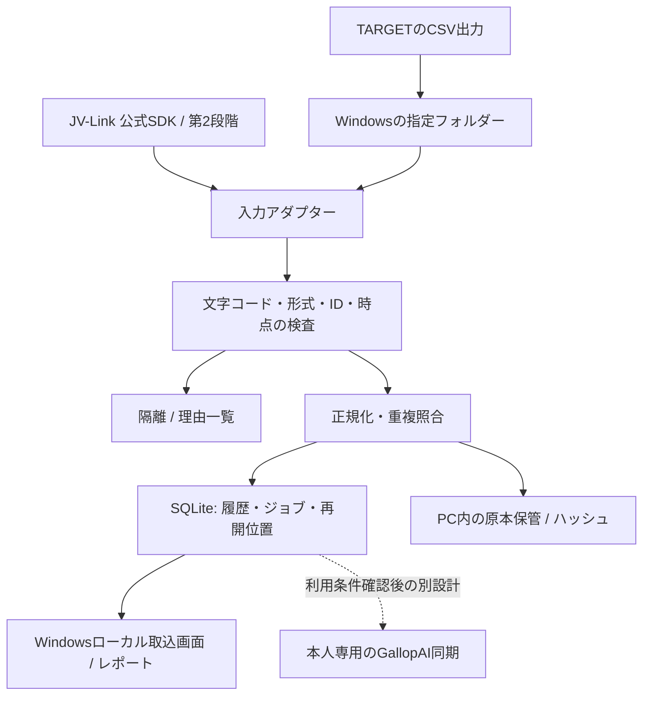

# TARGET / JRA-VAN 自動取込 設計案 v1

状態: 設計レビュー用。実装・データ取得・保存・クラウド同期は未実施。
対象: Windows上のTARGET frontierJV / JRA-VAN Data Lab.を個人利用するGallopAIユーザー。
確認日: 2026-11-05。

## 1. 決定事項と自動化の範囲

### 第1段階: CSVフォルダー監視

ユーザーがTARGETからCSVを指定フォルダーへ出力した後、検出・形式判定・検査・レース別照合・ローカル蓄積・結果報告まで自動で進める。レースごとのファイル選択やスクショ確認は不要。初回はドライランを見て、対象範囲と自動確定ポリシーをユーザーが設定する。

**TARGETからCSVを書き出す操作自体を、この段階で自動化したとは扱わない。** TARGETの画面をマウスで自動操作する方式は、画面変更・待機・途中ダイアログに弱いため標準構成にしない。

### 第2段階: JV-Link取得アダプター

同じ正規化・検査・蓄積処理へ、公式JV-Linkからの取得アダプターを追加する。取得条件を設定後、初回の期間取得と以後の更新取得をWindows側で行う。SDKで対応するデータ種別・取得区間・戻り値・更新方式を確認してから実装し、現時点では存在未確認のAPI名や全種別一括取得を約束しない。

### 保存先の初期方針

初期版は本人のWindows PC内に限定する。契約データをGitHub、Codespaces、外部AI、公開サイト、既存Firestoreへ自動転送しない。本人専用クラウドの可否も公式条件・利用形態の確認を要するため、技術的に可能であることだけで有効化しない。クラウド同期は別の機能フラグと設計審査に分ける。初期版のローカル処理は、その確認待ちに依存させない。

## 2. 現在のGallopAIとの差分

確認したmain: `1705aaf`。PR #20・#21・#22・#23は設計確認時点で未マージ。#23は#22を比較先とした表示改善。実装時に各PRのマージ順を再確認する。

- `parseTargetEntryCsv` は特定の25列形式を想定し、レース日付・IDを返さない。
- `parseTargetResultCsv` は日本語ヘッダーの特定項目を想定する。
- 公式の成績CSVは基本/フルセット・オッズ有無等で列が変わり、現行パーサーへそのまま通せる保証はない。
- `decodeJapaneseBytes` と `parseCsv` は再利用候補。ただし不正バイトを置換して通す既存の最終フォールバックは自動確定では使わず、文字コード不明として隔離する。閉じていない引用符等も自動取込専用の厳密検査で拒否する。
- `makeRaceId` の日付・競馬場・Rから作る既存IDは保持し、JRA-VAN側IDは対応表で関連付ける。
- `saveCloudRace` はmergeで既存レースを書き得るため、並行する自動ジョブでのcreate-only保証はない。初期版では呼ばない。将来の同期で読込確認だけを原子的な重複防止だと扱わない。
- 出走表・調教の照合、既存特徴量計算、`canSaveRace` 等は再利用するが、結果だけのレースを「全ソース完備」と偽って通さない。履歴蓄積と予想可能を別状態で管理する。

## 3. 構成



Windows補助プロセスとローカル画面で構成する。CSV段階の実装言語は既存JSの再利用を優先して選定し、JV-Link段階ではインストール済みSDKの32/64bitと対応環境を確認して、必要なら別プロセスのC#/Python等にする。JV-LinkのCOMをブラウザーやLinuxのCodespaces内で直接呼ばない。

原本・ローカルDBはGit作業フォルダー外のユーザーデータ領域（例 `%LOCALAPPDATA%\GallopAI\ingest`）へ置く。監視対象もユーザーが選択し、PC全体を巡回しない。既存のTARGETデータベースを直接書換えたり、非公開の内部ファイル構造を取得APIの代用にしたりしない。

## 4. フォルダーと日常の操作

```text
%LOCALAPPDATA%\GallopAI\ingest\
  inbox\results\
  inbox\entries\
  inbox\training\slope\
  inbox\training\wood\
  originals\       # 取込処理が作る原本コピー。元CSVは変更しない
  database\        # SQLite / WAL。既存Firestoreのmigrationではない
  reports\         # 集計・不一致・隔離理由
  backups\         # PC内の復元用バックアップ
```

フォルダー名はヒントにしか使わず、形式・必須列・データ内容でも検査する。ファイル名だけで資料種別を決めない。元CSVの移動・削除・リネームはしない。

操作は「監視開始」「一時停止」「今すぐ照合」「失敗分を再試行」「レポート表示」。監視中の正常な新規レコードは、初回に設定したポリシーに従ってPC内へ自動確定できる。重複・不一致・訂正競合は止めて例外一覧へ回し、正常分は継続する。

画面には対象期間、総検出件数、取込済みレース/馬/調教セッション数、同一重複、訂正版待ち、隔離、最終成功時刻、未完了ジョブを表示する。「履歴あり」と「予想用入力がそろった」を分け、今回のRTや調教がない馬を自動的に予想可能と表示しない。

## 5. CSVアダプターと仕様固定

出力プロファイルの例は `target-results-full-v1`、`target-entry-approved-v1`、`target-training-slope-approved-v1`。各プロファイルに次を持たせる。

- TARGETのバージョン、出力メニュー、基本/フルセット、オッズ等の追加設定、ヘッダー有無、区切り、文字コード、列数と列名/位置、各コード形式。
- ヘッダー付きは名称と必須列で照合。ヘッダーなしはユーザーが選択した公式仕様のプロファイルを必須とし、列数だけで推測しない。
- オッズ追加や前走データの有無で列がずれる形式は、対応する固定プロファイル以外は隔離する。列のずれを「読めた数値」で埋めない。
- UTF-8（BOM有無）とCP932/Shift_JISは厳密に復号する。Excelで開いて再保存する前の原本を使う。デコードが曖昧なら確認待ち。
- 日付、競馬場、レース番号、馬番、頭数、着順・異常コードの整合を検査する。全角数字・空白の正規化と、識別子の変更は分離する。
- 年2桁は指定した取得期間と公式の対応規則で確定する。候補が複数なら自動で世紀を推測しない。
- 公式CSVの表示項目が当時の値ではないもの（調教師・所属/賞金・馬主等）は最新属性と明記し、過去予想の事前特徴量へ流用しない。

次回PCで少量を確認してからプロファイルを確定する。実データやCSVをこのチャットや公開GitHubへ送ることを前提にしない。列名・設定・ローカル検査結果だけで対応範囲を決め、テスト用フィクスチャは人工データで作る。

## 6. 識別とレコード粒度

| 種類 | 照合キー | 注意 |
| --- | --- | --- |
| レース | 仕様が判明したsourceRaceIdと、日付・場コード・R | 内部の既存raceIdとの1対1対応を確認。名前だけでは結合しない |
| 出走馬 | sourceRaceId＋馬番、血統登録番号 | 馬番と登録番号を両方照合。取消・除外も消さない |
| 馬 | 提供元と形式を付けた血統登録番号 | 8桁等の形式を文字列で保持。未知の形式を年や桁の補完で捏造しない |
| 調教 | 登録番号＋実施日時＋コース＋提供元セッションキー | 同じ日の複数本を単に1本へ潰さない |
| 元ファイル | SHA-256＋プロファイル版 | 同じ内容の別名ファイルも同一重複として扱える |
| 元レコードの版 | 種類＋自然キー＋提供元更新情報＋正規化ハッシュ | 訂正前・訂正後を保持し、採用版だけ別管理 |

レースID、馬ID、騎手ID、調教師IDは文字列として保存する。先頭0・18桁等をJS NumberやExcel数値へ変換しない。TARGETの英字プレフィックス設定もプロファイルとして明示し、未知の文字を勝手に除去しない。

新旧IDの変換は公式の対応規則を確認して実装し、馬名一致や「末尾を切ればよい」等の未検証ルールで混在形式を結合しない。馬番と登録番号が矛盾する場合は隔離する。

## 7. ローカルDBと再開

以下は新しいPC内の取込管理用テーブルで、Firestoreへの新コレクションやmigrationを要求しない。

- `source_files`: ハッシュ、プロファイル、件数、読込状態、取得日時。
- `source_records`: 自然キー、版、イベント日、提供元の更新時刻、観測時刻、原本参照、正規化ハッシュ。
- `race_identity` / `horse_identity`: 提供元IDと既存IDの対応、検査結果。
- `race_entries` / `race_results` / `workouts`: 型別の正規化データ、出典の版。
- `ingest_jobs`: 期間・対象種別・処理状態・再開位置・失敗理由。
- `local_materializations`: ローカル画面用の採用版と品質状態。

処理状態は `detected → waiting_stable → parsed → validated → committed`。形式不明/矛盾は `quarantined`、一時障害は `retry_wait`。DBトランザクションでレコード確定とチェックポイントを一緒に更新する。

ファイル監視は少なくとも1回の配送を想定し、通知漏れを定期走査で補う。サイズと更新日時が一定時間安定し、読み取り可能になってから解析し、読込前後のハッシュ/サイズ変化があればやり直す。コピー途中のCSVを確定しない。

同一レコード・同一ハッシュはスキップ。異なる内容は旧版を削除せず新しい版として保持する。提供元の更新順序がない場合、ファイル更新時刻や最後にコピーした順だけで正しい訂正版と決めず確認待ちにする。停止・PC再起動後は未確定の小さなチャンクから再開できる。

バックアップはSQLiteの整合したバックアップ機能を使い、書込中のDBファイルだけを単純コピーしない。原本ハッシュとDBの版を合わせて復元確認する。再試行でレース数が増殖しないことを受入条件とする。

## 8. 日付・時点の分離

少なくとも以下を分離する。

- `eventAt`: レース・調教が実施された日時。
- `sourceUpdatedAt`: 提供元が示した更新日時（ある場合）。
- `observedAt`: このPCが実際に取得した日時。
- `availableBefore`: 発走前の利用可能性を根拠付きで確認できる場合だけ設定。取得時刻から過去へ遡って捏造しない。
- `availabilityClass`: 発走前スナップショット / 事後再構成 / 最新属性 / 結果専用 / 不明。

結果、確定人気・確定オッズ、払戻、対象レースの走破時計・補正タイム・PCIは結果用領域に限定する。過去レースの結果を後日の予想の履歴にすることと、予想対象自身の結果を入力にすることを区別する。

レース前人気/オッズは観測時刻付きの別レコード。結果CSVの確定値を事前値として扱わない。過去5年分の結果を今取得しただけでは、5年分の発走前スナップショットを再現できたとはしない。JV-Linkの過去データで当時の途中版を取得できるかも、公式仕様で確認するまで未確定。

調教を対象レースへ関連付けるときは血統登録番号、実施日時、コースを使う。初期の関連付け期間は明示設定とし、後の調教を混ぜない。単に「レース前の直近3本」へ絞ってデータを捨てず、全セッションをローカルに残して特徴量側で選ぶ。未登録馬・識別不能・日付不明は自動結合しない。

## 9. GallopAI既存構造への適合

Horseルートの正式6ブロック `raw / features / quality / ocr / logs / versions` を維持する。原本への参照、提供元、形式、版、ID、時点分類、欠損理由は各ブロック内で保持し、7つ目のルートブロックを追加しない。原本ファイルそのものはPC内に保管し、Horseごとに巨大な元CSV全体を複製しない。

競馬ブックのRTを、TARGETの補正タイム・ZIなどで代用しない。提供されない値はnullと理由を保持する。追い方・短評等の提供範囲も同一と仮定しない。JRA-VANの全調教（準備運動を含む）を競馬ブックの追い切り選抜データと同じ本数特徴量に無条件で混ぜない。

既存の `raw.targetText / trainingPdf / resultCsv` 等へ互換データを渡す場合も、出典がJRA-VANであることと、どの正規化フィールドを使ったかを保持する。結果CSVの項目だけで架空の「発走前出走表」を作らない。正規化データから既存ソース型へのアダプターは独立実装し、品質ゲートを迂回しない。

構造化CSVの読み取りはOCRではない。OCR信頼度100%を作って平均を押し上げない。`ocr` ブロックを維持したまま非OCR・適用外と表現する方法、および既存品質計算のOCR依存部分は、実装前の適合テストで確定する。既存PDF経路は変えない。

結果しかないレースは履歴倉庫への蓄積まで可能だが、既存の予想・保存の必須入力がそろわない場合は「履歴のみ」とする。RTや調教を架空補完して保存条件を満たさない。データ件数と評価可能レース数を別表示する。

## 10. 5年分の初回取得と日常更新

1. 初回は1開催日程度で、形式とID・項目範囲をドライラン検証する。
2. 1か月へ拡大して、読込時間・DB/原本サイズ・必要な更新履歴・復元を計測する。
3. 1年分で欠損、重複、訂正、データ種別ごとの提供範囲を確認する。
4. 5年分は年/月単位のジョブへ分割し、停止・再開できるようにする。年数から固定件数を推測せず、TARGET/SDKの取得対象件数と照合する。
5. 以後はフォルダー再走査/差分取得を行う。PCのスリープ・電源OFF中に処理が続くとは扱わない。復帰時にチェックポイントと重複排除で追いつく。

全5年分の即時Firestore全件同期は標準にしない。PC内の全履歴と、画面・予想で必要な対象範囲を分ける。転送を認められた場合も、月/レース単位に分割してAPI上限・費用・通信量を実測し、不要な大量読込を避ける。

## 11. 将来クラウド同期を実装する条件

利用条件に合うことを確認した場合に限る別フェーズ。コードが対応するまで現在のPDF一括保存ボタンへJRA-VANの生データを直接渡さない。

- 本人のFirebaseログインとUIDで保存先を束縛し、別アカウント切替時はそれ以降を中断する。JWT・利用キーをファイルやGitへ書かない。
- `users/{uid}` の現行ルールと6ブロックを維持する。JRA-VAN利用キーはJV-Linkの本人PC設定に置き、Firestore・ブラウザー・Codespacesへ配布しない。
- 既存PDFレースとのID対応を照合し、同一・補完候補・競合を区別。初期同期は既存レースの自動上書き不可。内容が違う既存レースはレビュー待ち。
- 自動同期用の並行ジョブは1所有者につき1系統に制限する。ただし既存SaveEngineが原子的なcreate-onlyを提供しない限り、別端末からの書込競合の完全保証にはならない。排他/条件付き確定は別の具体的な設計課題とし、読込後の確認だけで解決済みとしない。
- 常駐PCから通信する場合も、既存SaveEngineのバリデーションと正式ブロック生成を再利用する。認可や既存保存を迂回したAdmin SDK直書きは採用しない。
- 本人専用iPhone画面の提供はこのフェーズの先。初期のlocalhost UIを公開トンネルでインターネットへさらす方式にはしない。

## 12. 受入テストと故障時の挙動

| ケース | 期待する結果 |
| --- | --- |
| 同じCSVを2回、別名でも投入 | 同一重複。件数・集計が増殖しない |
| TARGETが書込中のファイル | 待機し、途中データを確定しない |
| 基本/フルセット・オッズ追加・列順変更 | 承認済みプロファイルだけ受理。未知形式は隔離 |
| CP932・BOM・引用内カンマ・改行・大きなID | 正確に復号/パースし、IDの桁/先頭0を保持 |
| 途中停止・再起動・更新通知漏れ | チェックポイントと定期走査で再開し、二重確定しない |
| 同じレコードの訂正・逆順到着 | 旧版を保持。順序が根拠付きで分からなければ採用変更しない |
| 馬番/血統番号矛盾・頭数不一致・不正日付 | 該当レース/レコードを隔離。正常な別レースは継続 |
| 中止・取消・除外 | 状態を保持し、架空の着順を作らない |
| 未来調教・確定オッズ・最新属性 | 予想前入力へ混入しない |
| RTなし・調教不足・OCR適用外 | 値や信頼度を捏造せず、欠損/適用外を区別 |
| 既存PDFレースとの衝突 | 無断上書き・削除しない |
| JV-Link失敗・PC休止・キー認証失敗 | 戻り値に沿って待機/再試行/要操作を区別し、成功扱いしない |
| クラウド未許可・未設定 | ネット転送0件。ローカル処理だけで利用可能 |
| ローカル復元 | 同じ原本と版を再現でき、追跡情報が失われない |

## 13. 次回Windowsで確認する最小項目

操作一覧は `TARGET_PC_NEXT_STEPS.md` に分離する。まずTARGETのバージョンと利用できるCSV出力設定、少量の列構成、JV-Linkの有無/bit数を本人PC内で確認する。5年分の大量出力や設定変更を先に行う必要はない。

実装を始める前の未確定事項: 現物のCSV形式・ID形式、坂路/ウッドそれぞれの提供期間と出力項目、発走前時点を証明できるデータ、構造化ソースの品質/OCR表現、本人専用クラウド利用の条件。これらを確定するまで「全レース・全項目・完全自動同期が利用可能」とは案内しない。

## 14. 公式根拠（2026-11-05確認）

- [成績CSV仕様](https://targetfaq.jra-van.jp/faq/detail?hot_list=true&id=681&site=SVKNEGBV): 基本/フルセット等で列が変わる、識別コード、確定値の区別に使用。
- [坂路調教一覧](https://targetfaq.jra-van.jp/faq/detail?category=104&id=270&site=SVKNEGBV): CSV出力設定、全時計を含むこと、一部属性が最新状態である注意を確認。
- [JRA-VAN SDK案内](https://developer.jra-van.jp/t/topic/45): 公式JV-Link、32/64bit、仕様書・検証ツールの存在を確認。実装時は配布中の仕様書を参照する。
- [Data Lab.製品案内](https://jra-van.jp/dlb/): Windows向けサービスとJV-Linkの位置付け。
- [JRA-VAN利用規約 第7条](https://jra-van.jp/info/rule.html): 本人の私的利用と第三者利用/公開の制約。本人専用クラウド等の個別形態の許容を、この設計だけで断定しない。

本PRは設計書のみ。実装完了・動作確認済みの機能を示すものではない。
